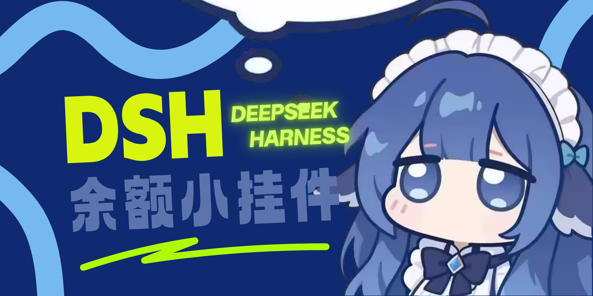

# 小鲸鱼桌宠 · dsh-whale-desktop

> DeepSeek Harness（DSH）鲸鱼挂件的**对话增强衍生版**，外加一个**独立桌面小鲸鱼**。



---

## 致谢与原项目

本项目**基于 [MeteorNOX](https://github.com/MeteorNOX) 的
[DeepSeek-Balance-Whale-Widget](https://github.com/MeteorNOX/DeepSeek-Balance-Whale-Widget)
修改而来，原许可证为 MIT License。**

| 项目 | 内容 |
|---|---|
| 上游项目 | [DeepSeek-Balance-Whale-Widget](https://github.com/MeteorNOX/DeepSeek-Balance-Whale-Widget) |
| 原作者 | **MeteorNOX** |
| 原许可证 | **MIT License**（`Copyright (c) 2026 MeteorNOX`） |
| 本衍生作品 | **MIT License**（同为 MIT，兼容；原版权声明完整保留于 [`LICENSE`](LICENSE)） |
| 基于的上游版本 | `0.5.1` |

> ⚠️ **素材例外**：上游明确声明 `assets/**` 与 `icon.png`（图片 / 动图 / 音效）**不在 MIT 范围内**，
> 按 as-is 随插件分发、不授予再许可。本项目原样保留这些文件用于运行，
> **不对其主张任何版权**。详见 [`THIRD_PARTY_NOTICES.md`](THIRD_PARTY_NOTICES.md)。

---

## 本项目做了什么

在上游「余额挂件」基础上新增：

### 1. 小鲸鱼对话气泡（DSH 内）

- 点鲸鱼 → 弹出气泡 → 直接打字聊天
- 支持**推理等级** Off / Low / High
- 支持**对话历史轮数**可选（无历史 / 1~20 轮，默认无历史最省 token）
- **气泡与鲸鱼互斥**：有授权提醒时提醒优先

### 2. 独立桌面小鲸鱼（Windows）

- 飘在所有窗口上方的**独立小程序**，不依赖 DSH 页面
- 与 DSH 客户端**同生命周期**：DSH 启动后才出现，DSH 退出后整体退出
- 显示余额 / 今日已用 / 峰谷时段（直接读取 DSH 插件账本）
- 双击 / 右键双击打开气泡对话，4 套形象可切换

### 3. 授权提示气泡音

需要你点「同意」时，额外播放提醒音；未处理会重复提醒（最多 3 次）。

---

## 安装

### 环境要求

| 项目 | 要求 |
|---|---|
| **Node.js** | **>= 20**（`package.json` 的 `engines` 已声明） |
| **兼容的 DSH 版本** | **>= 0.2.0**（需要 `webServer` / `credentials` / `connection` 三个服务） |
| 操作系统 | Windows 10 / 11（桌面小程序需要 WebView2 运行时，Win11 自带） |

### 方式 A：从 npm 安装

```bash
dsh plugin --profile web add dsh-whale-desktop
```

### 方式 B：从 GitHub 安装

```bash
dsh plugin --profile web add github:qingfenganshi/dsh-whale-desktop
```

### 方式 C：本地目录安装

```bash
dsh plugin --profile web add link:D:\path\to\dsh-whale-desktop
```

### ⚠️ 安装后必须重启

```
1. 完全退出 DSH 客户端（含系统托盘）
2. 重新打开
3. 在浏览器中按 Ctrl + F5 强制刷新
```

**只刷新页面是不够的** —— 宿主侧代码（路由、凭据接口）需要客户端重启才会加载。

### 桌面小程序（可选）

```bash
# 用 .NET Framework 自带的编译器构建
csc /target:winexe /out:DesktopWhale.exe /r:System.Windows.Forms.dll /r:System.Drawing.dll ^
    /r:System.Core.dll /r:System.Web.Extensions.dll /r:System.Net.Http.dll ^
    desktop/DesktopWhale.Core.cs desktop/DesktopWhale.Bubble.cs
```

首次运行后，右键双击鲸鱼 → 点 🔑 填入你自己的 DeepSeek API Key。

---

## 配置 API Key

对话功能需要 DeepSeek API Key：

1. 访问 <https://platform.deepseek.com/api_keys> 创建
2. 在小鲸鱼气泡里点 🔑 → 粘贴 → 保存

**Key 只写入 DSH 官方凭据服务，不保存在本项目的配置文件里。**

> 🔒 **分享前请先清空**：气泡里点 🔑 → 点「清空」，会同时删除本地文件与 DSH 凭据里的 Key。

---

## 支持的模型

本项目使用 DeepSeek 官方 API。**不同账号可用的模型可能不同**，请先确认：

```bash
curl https://api.deepseek.com/models -H "Authorization: Bearer <你的key>"
```

当前代码默认使用：

| 推理等级 | 模型 |
|---|---|
| Off / Low | `deepseek-flash` |
| High | `deepseek-v4-pro` |

如果你的账号没有这些模型，请修改 `lib/index.js` 的 `CHAT_MODEL` 常量。

---

## 目录结构

```text
dsh-whale-desktop/
├── package.json              # DSH 插件元数据（dsh.bundle.patch 指向 cordis.patch.yml）
├── cordis.patch.yml          # 插件挂载声明
├── LICENSE                   # MIT（保留原作者版权 + 本项目修改声明）
├── THIRD_PARTY_NOTICES.md    # 上游项目与素材例外声明
├── PROVENANCE.md             # 上游素材来源说明（原样保留）
├── lib/
│   ├── index.js              # 宿主侧：余额 + 对话 + 凭据 + 桌面程序启停
│   └── accounting.mjs        # 记账内核
├── assets/
│   ├── whale-widget.js       # 前端挂件（含对话气泡）
│   └── ...                   # 图片 / 音效（非 MIT，见 NOTICES）
└── desktop/
    ├── DesktopWhale.Core.cs    # 桌面小程序主程序
    └── DesktopWhale.Bubble.cs  # 桌面版对话气泡
```

---

## 许可证

本项目代码以 **MIT License** 发布，原版权声明完整保留。
美术素材（`assets/`、`icon.png`）**不在 MIT 范围内**，见 [`THIRD_PARTY_NOTICES.md`](THIRD_PARTY_NOTICES.md)。

---

## 免责声明

本项目与 DeepSeek 公司无隶属关系。"DeepSeek" 为其商标，此处仅用于说明兼容对象。
使用本项目产生的 API 费用由使用者自行承担。
